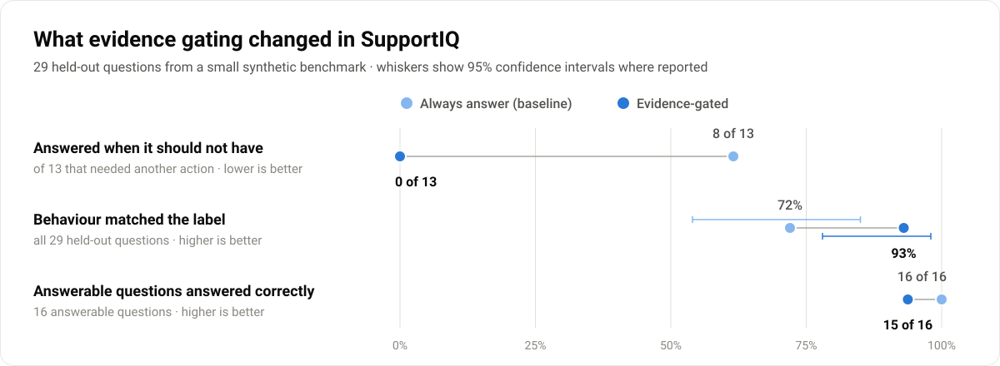

<!--
  Profile README for github.com/Tulsee
  Banner and chart are hand-made SVGs in /assets, each with a dark and a light version.
  The contribution snake is redrawn daily by .github/workflows/snake.yml.
-->

<picture>
  <source media="(prefers-color-scheme: dark)" srcset="assets/hero-dark.svg">
  <source media="(prefers-color-scheme: light)" srcset="assets/hero-light.svg">
  
</picture>

  
  
  
  

## About

I'm a software engineer in Kathmandu and an MSc candidate in Data Science and Computational Intelligence at Coventry University. One question runs through my work: **how can a learned model tell when its evidence is too weak to answer?** I build systems that answer only when they should, then measure whether they really do.

- **Now:** an MSc thesis on multimodal deep learning that fuses volumetric MRI features with clinical metadata to classify Alzheimer's disease
- **Building:** [SupportIQ](https://github.com/Tulsee/supportIQ), a help desk whose assistant answers, asks, escalates or declines depending on its evidence
- **Next:** doctoral research on reliable and multimodal deep learning

## Research interests

<table>
  <tr>
    <td width="33%" valign="top">
      <b>Uncertainty and abstention</b> 
      Selective prediction, deferral to people, and guarantees on the errors a model still makes
    </td>
    <td width="33%" valign="top">
      <b>Robust multimodal learning</b> 
      Combining imaging and clinical data when one input is missing or unreliable
    </td>
    <td width="33%" valign="top">
      <b>Trustworthy retrieval</b> 
      Hybrid search, evidence checks, and evaluation that others can reproduce
    </td>
  </tr>
</table>

## Featured: SupportIQ

<a href="https://github.com/Tulsee/supportIQ">
  <picture>
    <source media="(prefers-color-scheme: dark)" srcset="assets/supportiq-dark.svg">
    <source media="(prefers-color-scheme: light)" srcset="assets/supportiq-light.svg">
    
  </picture>
</a>

An open-source help desk whose assistant checks its evidence before it replies: it answers with citations, asks a clarifying question, escalates when documents disagree, or declines. Hybrid BM25 and dense retrieval with cross-encoder reranking reaches MRR@10 0.96, invented citations are removed, a contradiction scanner flags conflicting documents, and the whole system runs on a laptop CPU. The chart shows the trade-off honestly: one answerable question fewer, in exchange for no unwarranted answers.

**[Code](https://github.com/Tulsee/supportIQ)** · **[Evaluation](https://github.com/Tulsee/supportIQ#evaluation)**

## More work

<table>
  <tr>
    <td width="50%" valign="top">
      <b><a href="https://github.com/Tulsee/ann">Alzheimer's MRI classification</a></b> 
      VGG16 and ResNet50 compared in PyTorch with sensitivity, not accuracy, as the main criterion, because a missed early-stage case costs more than a false alarm. 
      PyTorch · transfer learning · medical imaging · <a href="https://doi.org/10.5281/zenodo.20199049">preprint</a>
    </td>
    <td width="50%" valign="top">
      <b><a href="https://github.com/Tulsee/rag_chatbot">Local RAG chatbot</a></b> 
      Private question answering over your own PDFs, with hybrid dense and sparse retrieval, source-page citations, and a harness that checks whether retrieved passages hold the evidence each answer needs. 
      Qdrant · BM25 · Ollama · LangChain
    </td>
  </tr>
  <tr>
    <td width="50%" valign="top">
      <b><a href="https://github.com/Tulsee/automated_hiring_process">Local AI hiring agent</a></b> 
      Explainable candidate scoring that reports matched and missing skills, with a human-in-the-loop pause before any hiring decision. In progress. 
      FastAPI · LangGraph · Qdrant · MongoDB
    </td>
    <td width="50%" valign="top">
      <b><a href="https://github.com/bettercollected/bettercollected">Bettercollected</a></b> open-source contributor 
      Built Discord, Slack and Google Sheets integrations for an open-source forms platform and resolved community-reported issues. 
      FastAPI · Next.js · MongoDB
    </td>
  </tr>
</table>

## Preprints

- **Sensitivity-prioritized comparative evaluation of VGG16 and ResNet50 deep learning architectures for early-stage Alzheimer's disease detection from brain MRI** 
  **S. Ghimire**, B. Thapa Magar, N. Adhikari, S. Neupane, S. Maharjan · Zenodo · 2026 · [doi:10.5281/zenodo.20199049](https://doi.org/10.5281/zenodo.20199049)
- **When reward is not grammar: A reward-action validity audit of deep reinforcement learning for English inflection** 
  N. Adhikari, **S. Ghimire**, S. Neupane · Research Square · 2026 · [doi:10.21203/rs.3.rs-10755274/v1](https://doi.org/10.21203/rs.3.rs-10755274/v1)
- **Transparent context-aware retrieval for mental health and substance use service navigation** 
  N. Adhikari, **S. Ghimire** · Research Square · 2026 · [doi:10.21203/rs.3.rs-10862112/v1](https://doi.org/10.21203/rs.3.rs-10862112/v1)
- **Demand forecasting for internet bandwidth using machine learning to enhance resource management in Nepal** 
  S. Maharjan, **S. Ghimire** · Research Square · 2026 · [doi:10.21203/rs.3.rs-10747280/v1](https://doi.org/10.21203/rs.3.rs-10747280/v1)

## Toolbox

<picture>
  <source media="(prefers-color-scheme: dark)" srcset="https://skillicons.dev/icons?i=py,pytorch,sklearn,matlab,fastapi,postgres,redis,mongodb,docker,githubactions,linux,aws,gcp,ts,nextjs&theme=dark">
  <source media="(prefers-color-scheme: light)" srcset="https://skillicons.dev/icons?i=py,pytorch,sklearn,matlab,fastapi,postgres,redis,mongodb,docker,githubactions,linux,aws,gcp,ts,nextjs&theme=light">
  
</picture>

Also: Qdrant, LangGraph, LangChain, Ollama, Celery, pandas, NumPy, PySpark

## Contributions

<picture>
  <source media="(prefers-color-scheme: dark)" srcset="https://raw.githubusercontent.com/Tulsee/Tulsee/output/github-snake-dark.svg">
  <source media="(prefers-color-scheme: light)" srcset="https://raw.githubusercontent.com/Tulsee/Tulsee/output/github-snake.svg">
  
</picture>
